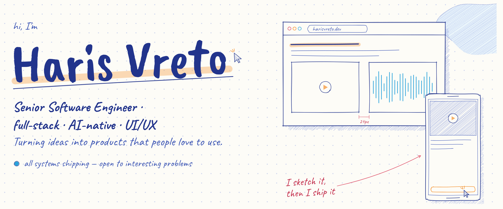
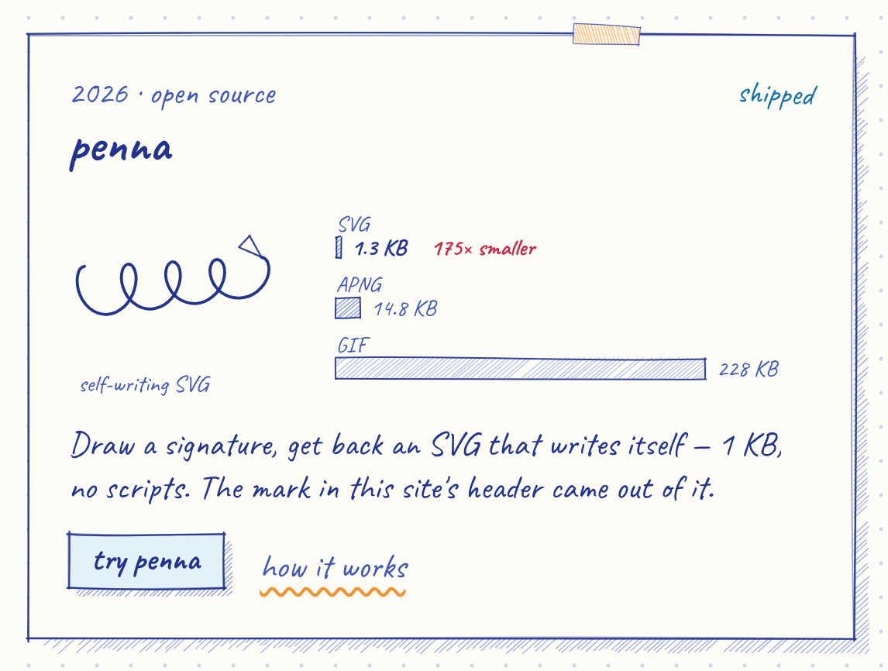
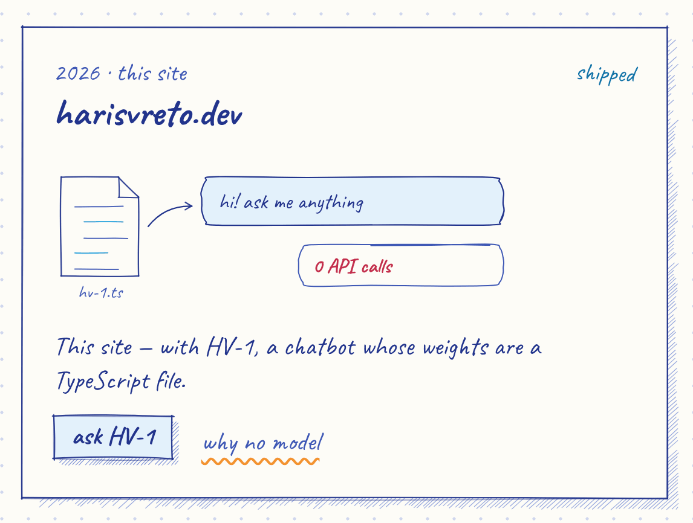

<a href="https://harisvreto.dev">
  <picture>
    <source media="(prefers-color-scheme: dark)" srcset="./banner-dark.png">
    
  </picture>
</a>

  <a href="https://harisvreto.dev"><b>harisvreto.dev</b></a> ·
  <a href="https://www.linkedin.com/in/harisvreto/">LinkedIn</a> ·
  <a href="https://harisvreto.dev/Haris-Vreto-CV.pdf">CV</a> (or the <a href="https://harisvreto.dev/Haris-Vreto-CV-hand-drawn.pdf">hand-drawn one-pager</a>) ·
  <a href="https://harisvreto.dev/llms.txt">/llms.txt</a>

## hi 👋

I'm **Haris** — a senior software engineer at [Inkitt](https://www.inkitt.com) (San Francisco), working full-stack from Sarajevo. Ten-plus years across publishing, Web3 and healthcare; hobby UI/UX designer; AI running through every stage of my workflow — agentic coding, AI-assisted review, generated tests. The gap between *idea* and *shipped* has never been smaller, and I intend to keep abusing that.

- **building** — the Inkitt platform · [Penna](https://penna.harisvreto.dev) · HV-1, my portfolio's zero-API chatbot
- **based** — Sarajevo · GMT+1, SF hours
- **running on** — Bosnian coffee, unreasonable amounts
- **open to** — interesting problems

## penna

<a href="https://harisvreto.dev/projects/penna">
  <picture>
    <source media="(prefers-color-scheme: dark)" srcset="./penna-dark.png">
    
  </picture>
</a>

**[Penna](https://penna.harisvreto.dev)** — draw a signature, watch it write itself back, then take it away as an SVG that animates on its own. No JavaScript in the file. **1.3 KB.**

Every stroke becomes one `<path>` with a `stroke-dasharray` equal to its own arc length, and one generated `@keyframes` rule walks `stroke-dashoffset` to zero during that stroke's slice of a shared timeline. There's no runtime, because CSS *is* the runtime. Stroke duration comes from arc length rather than a fixed number, which is the whole difference between reading as handwriting and reading as playback.

The same signature as an animated GIF is 228 KB — **175× bigger**, and it looks worse. The one signing off this page had to be APNG instead: GitHub proxies images and strips the `<style>` block, so a self-animating SVG arrives frozen. That one rendering quirk is the entire reason the APNG exporter exists.

Vite · React · TypeScript, with the geometry/timeline/SVG engine kept dependency-free. 40 tests, Lighthouse **100 across all four** categories.

## harisvreto.dev

<a href="https://harisvreto.dev">
  <picture>
    <source media="(prefers-color-scheme: dark)" srcset="./site-dark.png">
    
  </picture>
</a>

**[harisvreto.dev](https://harisvreto.dev)** is a page from a sketchbook: ballpoint blue on dotted paper, an orange highlighter, a red pencil for measurements. Every outline, hatch and doodle on it is drawn at runtime by a seeded pen — nothing is an image. Its centerpiece is **HV-1**, a chatbot with **zero API calls**: the "model" is a hand-written TypeScript intent matcher trained on exactly one career (mine). It streams answers, renders project cards and timelines inline, survives offline, and costs nothing to run. Sometimes the right model is no model.

The punchline: a real AI helped build the fake one — the whole site was developed agentically with Claude Code, then reviewed like any PR.

**Worth poking at over there:**

- 💬 Press <kbd>⌘K</kbd> / <kbd>Ctrl K</kbd> and ask HV-1 anything — or try `sudo hire haris`, `rm -rf /`, or "roast his tech stack"
- ✍️ The header signature writes itself on load — pure CSS on server-rendered markup, no JS
- 📏 Red-pencil redlines that measure the live layout; the numbers are real
- 📝 [Essays](https://harisvreto.dev/writing) on why the right model is often no model, why boring releases are a feature, and how a signature ends up smaller than a favicon
- 📄 Two CVs from one career: a hand-drawn one for people, and an ATS one generated at build time from the same data that powers the page, the chat and [`/llms.txt`](https://harisvreto.dev/llms.txt)
- 💯 Lighthouse 100 on accessibility · best practices · SEO, CLS 0, zero third-party requests, no cookies

**Stack these days:** TypeScript · React · Next.js · React Native · Node.js · NestJS · Rails · GraphQL · AWS — with Claude Code, Cursor and the Vercel AI SDK as the leverage layer.

## say hi

Fastest: **[harisvreto.astra@gmail.com](mailto:harisvreto.astra@gmail.com)** — or ask [HV-1](https://harisvreto.dev) anything first; it knows my decade of shipping cold.

  <picture>
    <source media="(prefers-color-scheme: dark)" srcset="./signature-dark.png">
    
  </picture>
   
  signed with <a href="https://penna.harisvreto.dev">Penna</a> — all systems shipping, open to interesting problems

