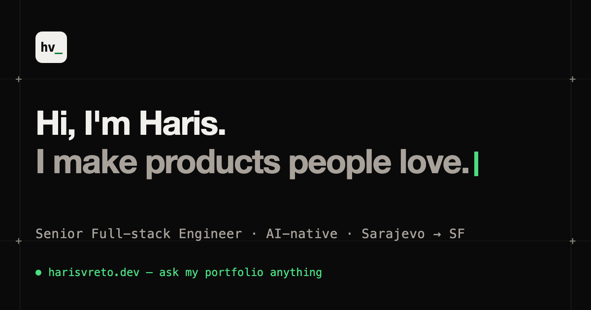

<div align="center">



### `hv_` — I make products people love.

**[harisvreto.dev](https://harisvreto.dev)** · [LinkedIn](https://www.linkedin.com/in/harisvreto/) · [CV (PDF)](https://harisvreto.dev/cv.pdf) · [/llms.txt](https://harisvreto.dev/llms.txt)

</div>

---

## `$ whoami`

Hi, I'm **Haris** 👋 — a senior full-stack engineer at [Inkitt](https://www.inkitt.com) (San Francisco), shipping from Sarajevo. Ten-plus years across publishing, Web3 and healthcare; hobby UI/UX designer; AI running through every stage of my workflow — agentic coding, AI-assisted review, generated tests. The gap between *idea* and *shipped* has never been smaller, and I intend to keep abusing that.

```text
BUILDING    Inkitt platform · HV-1 (my portfolio's zero-API chatbot)
BASED       Sarajevo · GMT+1, SF hours
RUNNING ON  Bosnian coffee, unreasonable amounts
OPEN TO     interesting problems
```

## `$ cat portfolio.md`

My portfolio, **[harisvreto.dev](https://harisvreto.dev)**, is framed as a dev-tool product page where the product is me. Its centerpiece is **HV-1**, a chatbot with **zero API calls** — the "model" is a hand-written TypeScript intent matcher trained on exactly one career (mine). It streams answers, renders project cards and timelines inline, survives offline, and costs nothing to run. Sometimes the right model is no model.

The punchline: a real AI helped build the fake one — the whole site was developed agentically with Claude Code, then reviewed like any PR.

**Worth poking at over there:**

- 🟩 Terminal easter eggs — try `sudo hire haris`, `rm -rf /`, or "roast his tech stack"
- 📐 A structural 96px grid drawn with real borders, corner marks on every rail intersection
- 🖤 Monochrome + phosphor green — the only colors are signals: carets, status LEDs, deploy pings
- 📄 An ATS-friendly CV generated at build time from the same data that powers the page, the chat and [`/llms.txt`](https://harisvreto.dev/llms.txt) — nothing can drift
- 💯 Lighthouse 100/100/100 on SEO · a11y · best practices, CLS 0, zero third-party requests, no cookies

**Stack these days:** TypeScript · React · Next.js · React Native · Node.js · NestJS · Rails · GraphQL · AWS — with Claude Code, Cursor and the Vercel AI SDK as the leverage layer.

## `$ ping haris`

Fastest: **[harisvreto.astra@gmail.com](mailto:harisvreto.astra@gmail.com)** — or ask [the terminal](https://harisvreto.dev) anything first; it knows my decade of shipping cold.

<div align="center">

`$ status: ● all systems shipping — open to interesting problems`

</div>
